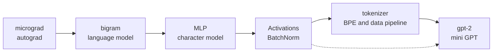

# Zero to Hero: Chinese Learning Notes

[English](README.md) | [中文](README.zh-CN.md)

This repository contains study notes, experiments, and code implementations for Andrej Karpathy's **Zero to Hero** neural network course.

- Original course repository: [karpathy/nn-zero-to-hero](https://github.com/karpathy/nn-zero-to-hero)
- The notes and explanations are primarily written in Chinese to make the course easier to follow and reproduce.

## Repository structure

1. [`micrograd/`](micrograd/)
   - Micrograd implementation and experiments
   - Chinese study notes
2. [`bigram/`](bigram/)
   - Bigram language model implementation and experiments
   - Chinese walkthrough notes
   - Data files and generated examples
3. [`MLP/`](MLP/)
   - Multi-layer perceptron implementation and experiments
   - Chinese study notes
4. [`gpt-2/`](gpt-2/)
   - A character-level mini GPT built from scratch with PyTorch
   - Transformer, self-attention, training, and text generation walkthrough
5. [`Activations/`](Activations/)
   - BatchNorm, activation distributions, and gradient-flow experiments
   - A continuation of the `makemore` MLP lessons
6. [`tokenizer/`](tokenizer/)
   - From-scratch tokenizer concepts and BPE/subword experiments
   - A ByteLevel BPE tokenizer training script compatible with Hugging Face
   - Chat template and next-token prediction data-pipeline examples

## Project relationship

The projects build from the basic components of neural networks toward language
model training and inference:



`tokenizer/` focuses on converting text into token IDs and preparing
input-target sequences, while `gpt-2/` consumes tokenized sequences to train a
Transformer language model.

## Custom tokenizer demo

The [`tokenizer/train_tokenizer.py`](tokenizer/train_tokenizer.py) script trains
a 6,400-token ByteLevel BPE tokenizer from
[`tokenizer/dataset/pretrain_hq.jsonl`](tokenizer/dataset/pretrain_hq.jsonl).
It reserves `<|endoftext|>`, `<|im_start|>`, and `<|im_end|>` for ChatML-style
conversation formatting, writes Hugging Face-compatible configuration files,
and verifies encode/decode plus chat-template behavior.

The training corpus is intentionally not tracked in Git because of its size.
Place the JSONL file at the path above before running the script:

```bash
cd tokenizer
pip install tokenizers transformers
python train_tokenizer.py
```

The generated tokenizer files are written to the repository-level `model/`
directory, which is ignored by Git.

## GPT-2 mini demo

Open [`gpt-2/gpt_dev.ipynb`](gpt-2/gpt_dev.ipynb) and run the notebook from top to bottom. It trains a roughly 0.21M-parameter character-level GPT on the Tiny Shakespeare dataset.

Install the required packages with:

```bash
pip install torch matplotlib numpy
```

The dataset is included as [`gpt-2/input.txt`](gpt-2/input.txt), so no additional download is required.

## Activations and BatchNorm experiments

The [`Activations/`](Activations/) folder contains two complementary notebooks and the `makemore` names dataset:

- [`makemore_part3_bn.ipynb`](Activations/makemore_part3_bn.ipynb) is the main learning notebook. It revisits the character-level MLP, adds BatchNorm, implements a small neural-network API, trains the model, and visualizes activation statistics.
- [`test.ipynb`](Activations/test.ipynb) is a separate one-cell statistics experiment. It generates heteroscedastic data, fits a linear regression, and plots residuals. It is useful for regression diagnostics, but it is unrelated to the main `makemore` training flow.
- [`names.txt`](Activations/names.txt) is the names dataset used by the `makemore` notebook.

Run `makemore_part3_bn.ipynb` first if you want to follow the main learning path. The `makemore` notebook requires PyTorch and Matplotlib; the separate statistics notebook requires `numpy`, `pandas`, `matplotlib`, `scipy`, and `statsmodels`.

## Learning path

The main projects are arranged from simple scalar automatic differentiation to language modeling:

```text
micrograd -> bigram -> MLP -> Activations/BatchNorm -> mini GPT
```

欢迎学习与交流！
