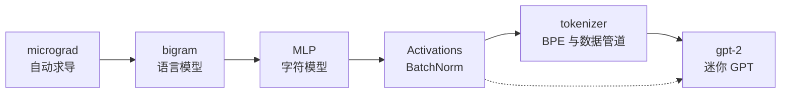

# Zero to Hero 中文学习笔记

[English](README.md) | [中文](README.zh-CN.md)

本项目为学习 Andrej Karpathy 的神经网络入门课程 “Zero to Hero” 的中文笔记与实践代码。

- 原项目地址：[https://github.com/karpathy/nn-zero-to-hero](https://github.com/karpathy/nn-zero-to-hero)
- 本仓库包含课程相关的代码实现、实验记录以及中文学习笔记，便于理解和复现课程内容。

## 目录结构

1. [`micrograd/`](micrograd/)
   - micrograd 相关代码与实验
   - 中文学习笔记
2. [`bigram/`](bigram/)
   - bigram 相关代码与实验
   - 中文拆解笔记
   - 数据文件与输出示例
3. [`MLP/`](MLP/)
   - 多层感知机（MLP）相关代码与实验
   - 中文学习笔记
4. [`gpt-2/`](gpt-2/)
   - 使用 PyTorch 从零实现的字符级迷你 GPT
   - Transformer、自注意力、训练和文本生成的完整讲解
5. [`Activations/`](Activations/)
   - BatchNorm、激活值分布和梯度传播实验
   - `makemore` MLP 课程的延伸内容
6. [`tokenizer/`](tokenizer/)
   - 从零理解 Tokenizer、BPE 和子词分词
   - 使用 ByteLevel BPE 训练兼容 Hugging Face 的分词器
   - Chat Template 和下一个 Token 预测数据管道示例

## 项目关系图

这些项目从神经网络基础组件逐步扩展到语言模型的训练与推理：



`tokenizer/` 负责把文本转换成 Token ID 并准备输入-目标序列，
`gpt-2/` 则使用这些序列训练 Transformer 语言模型。

## 自定义 Tokenizer Demo

[`tokenizer/train_tokenizer.py`](tokenizer/train_tokenizer.py) 会从
[`tokenizer/dataset/pretrain_hq.jsonl`](tokenizer/dataset/pretrain_hq.jsonl)
训练一个包含 6,400 个词条的 ByteLevel BPE 分词器。脚本会预留
`<|endoftext|>`、`<|im_start|>` 和 `<|im_end|>` 这三个 ChatML 对话控制符，
生成 Hugging Face 兼容的配置文件，并验证 Chat Template 以及编解码流程。

由于训练语料体积较大，JSONL 数据不会提交到 Git。运行前请将数据放置在
上述路径：

```bash
cd tokenizer
pip install tokenizers transformers
python train_tokenizer.py
```

生成的分词器文件会写入仓库根目录的 `model/` 文件夹，该文件夹已被 Git 忽略。

## GPT-2 迷你 Demo

打开 [`gpt-2/gpt_dev.ipynb`](gpt-2/gpt_dev.ipynb)，从上到下依次运行 notebook。该 notebook 使用 Tiny Shakespeare 数据集训练一个约 0.21M 参数的字符级 GPT。

安装所需依赖：

```bash
pip install torch matplotlib numpy
```

数据集已包含在 [`gpt-2/input.txt`](gpt-2/input.txt) 中，无需额外下载。

## Activations 与 BatchNorm 实验

[`Activations/`](Activations/) 文件夹包含两个互相补充的 notebook，以及 `makemore` 使用的 names 数据集：

- [`makemore_part3_bn.ipynb`](Activations/makemore_part3_bn.ipynb) 是主线学习 notebook。它重新实现字符级 MLP，加入 BatchNorm，构建简易神经网络 API，训练模型并可视化激活值分布。
- [`test.ipynb`](Activations/test.ipynb) 是一个独立的单 cell 统计实验，用于生成异方差数据、拟合线性回归并绘制残差图。它适合学习回归诊断，但与 `makemore` 主线训练流程无关。
- [`names.txt`](Activations/names.txt) 是 `makemore` notebook 使用的 names 数据集。

如果要按照主线学习，建议先运行 `makemore_part3_bn.ipynb`。`makemore` notebook 需要 PyTorch 和 Matplotlib；独立的统计 notebook 需要 `numpy`、`pandas`、`matplotlib`、`scipy` 和 `statsmodels`。

## 学习路径

主要项目按照从简单的标量自动求导到语言模型的顺序排列：

```text
micrograd -> bigram -> MLP -> Activations/BatchNorm -> mini GPT
```

欢迎学习与交流！
