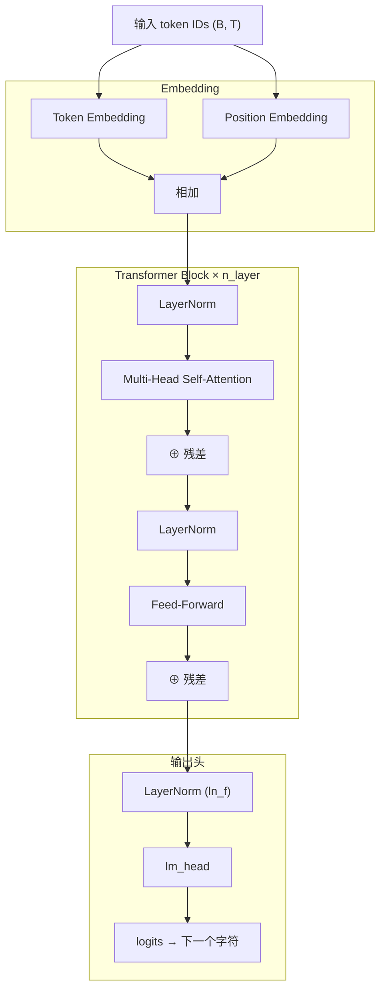

# GPT-Dev：从零构建迷你 GPT

用 **PyTorch** 从零实现一个字符级迷你 GPT（约 **0.21M** 参数），在 **Tiny Shakespeare** 数据集上训练并生成莎士比亚风格文本。

**主入口**：[`gpt_dev.ipynb`](gpt_dev.ipynb) — 按章节顺序从上到下运行即可。

---

## 项目结构

```
gpt-2/
├── gpt_dev.ipynb   # 完整教学 notebook（模型、训练、可视化）
├── input.txt       # Tiny Shakespeare 语料（~1MB）
└── README.md
```

---

## 你将学到什么

| 阶段 | 核心问题 |
|------|---------|
| 数据与分词 | 字符如何变成 token ID？训练样本 `x/y` 怎么构造？ |
| Bigram 基线 | 最简语言模型长什么样？和 GPT 差在哪？ |
| Self-Attention | 为什么需要 Q/K/V？因果 mask 是什么？ |
| Transformer | 多头、FFN、残差、LayerNorm 如何拼装？ |
| 训练与生成 | loss 怎么降？训练后模型「在看什么」？ |

---

## 本 Demo vs 真正 GPT

| | 本 notebook | 真正 GPT |
|---|------------|---------|
| 数据 | Tiny Shakespeare（`input.txt`） | 大规模网页、书籍、代码等 |
| 分词 | 字符级（vocab ≈ 65） | BPE / subword |
| 模型规模 | Mini GPT（~0.2M 参数） | 数十亿～数千亿参数 |
| 预测目标 | 下一个**字符** | 下一个 **token** |
| 训练目标 | Cross Entropy | Cross Entropy |
| 优化器 | AdamW | AdamW 等 |
| 注意力 | Causal Self-Attention | Masked Self-Attention |

**相同之处**：自回归建模、因果掩码、Transformer 堆叠、交叉熵损失 —— 原理一致，只是规模不同。

---

## Notebook 章节（16 节）

| 章节 | 内容 |
|------|------|
| 1 | 环境与依赖（PyTorch、matplotlib、numpy） |
| 2 | 加载 `input.txt` |
| 3 | 字符级分词器（`stoi` / `itos`） |
| 4 | 训练集 / 验证集划分（90% / 10%） |
| 5 | `block_size`、自回归 `x → y` 对齐 |
| 6 | `get_batch` 数据加载器 |
| 7 | **Bigram** 基线模型 |
| 8 | 训练 Bigram，观察 loss |
| 9 | **Self-Attention**：v1→v4 递进、Q/K/V、因果 mask |
| 10 | Attention 热力图、多头说明 |
| 11 | **LayerNorm** |
| 12 | Attention 在 GPT 里的分工（聚合上下文 vs `lm_head` 预测） |
| 13 | **完整 GPT**：架构图 + `Head` / `Block` / `GPT` 代码 |
| 14 | 训练 GPT（AdamW、train/val loss） |
| 15 | Loss 曲线、参数量分布、文本生成、训练后 Attention 可视化 |
| 16 | 总结与下一步 |

---

## 模型架构



### 核心公式：缩放点积注意力

$$\text{Attention}(Q, K, V) = \text{softmax}\left(\frac{QK^T}{\sqrt{d_k}} + \text{mask}\right)V$$

- **Q / K / V**：由输入 $X$ 经可学习矩阵 $W_Q, W_K, W_V$ 线性变换得到
- **mask**：下三角因果掩码，预测时不能看右边未来 token
- **分工**：Attention 负责「从左文借信息」；`lm_head` 负责「预测下一个字符」

### 默认超参数

| 参数 | 值 | 说明 |
|------|-----|------|
| `n_embd` | 64 | 嵌入维度 |
| `n_head` | 4 | 注意力头数（每头 16 维） |
| `n_layer` | 4 | Transformer 层数 |
| `block_size` | 32 | 上下文窗口长度 |
| `batch_size` | 16 | 批大小 |
| `learning_rate` | 1e-3 | AdamW 学习率 |
| `max_iters` | 500（可调至 5000） | 训练步数 |

参数量约 **0.21M**，其中 Attention 与 FFN 占主要部分。

---

## 环境需求

- Python 3.8+
- PyTorch
- matplotlib
- numpy

```bash
pip install torch matplotlib numpy
```

数据集已包含在仓库中（`input.txt`）。

---

## 运行方式

1. 打开 [`gpt_dev.ipynb`](gpt_dev.ipynb)
2. 从上到下依次运行各 cell
3. §14 开始训练：
   - **快速 demo**：`max_iters = 500`（约数分钟，CPU 可跑）
   - **更好效果**：`max_iters = 5000`（CPU 约 10–40 分钟）
4. 训练完成后运行 §15：
   - 查看 train/val loss 曲线
   - 自回归生成莎士比亚风格文本
   - 观察**训练后** Attention 权重热力图

### 预期效果（500 步 demo）

| 指标 | 初始 | 训练后（约） |
|------|------|-------------|
| train loss | ~4.4 | ~2.3 |
| val loss | ~4.4 | ~2.3 |

生成文本会从随机乱码逐渐变为有莎士比亚韵味的字符序列（字符级，非完整单词）。

---

## 核心代码组件

| 类 | 作用 |
|----|------|
| `Head` | 单头缩放点积注意力（§9 v4 的工程封装） |
| `MultiHeadAttention` | 多头并行 → concat → `proj` 混合 |
| `FeedForward` | `Linear → ReLU → Linear`（64 → 256 → 64） |
| `Block` | Pre-LN：`x + sa(ln1(x))`；`x + ffwd(ln2(x))` |
| `GPT` | Embedding → N×Block → `ln_f` → `lm_head` |

`Head` 与 §9 v4 逐步对照：

| 步骤 | v4 toy code | `Head.forward` |
|------|-------------|----------------|
| 1 | `Q,K,V = Wq(x), Wk(x), Wv(x)` | `query/key/value` 线性层 |
| 2 | `S = Q @ K.T / sqrt(d)` | `(q @ k.T) * C**-0.5` |
| 3 | `masked_fill` 因果掩码 | `wei.masked_fill(tril==0, -inf)` |
| 4 | `W = softmax(S)` | `F.softmax(wei, dim=-1)` |
| 5 | `Out = W @ V` | `wei @ value(x)` |
